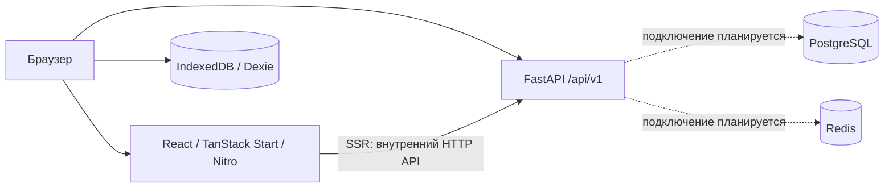

# Riff Battle

Веб-платформа для гитарных баттлов: участники получают общий барабанный луп,
за пять минут создают рифф во встроенном Piano Roll, затем анонимно слушают
работы, голосуют и смотрят результаты. В MVP можно играть гостем по нику
или зарегистрироваться и входить через аккаунт; регистрация не обязательна.
Хост создаёт комнату и запускает раунд минимум для двух игроков.

**Сейчас готов инженерный каркас.** Комнаты, Piano Roll, аудио и голосование
пока не реализованы, как и регистрация и вход в аккаунт. Стартовая страница
демонстрирует связь с API, счётчик
Zustand и запись заметки в IndexedDB. Требования к продукту предварительные.

Команда: Пинаев О.К. и Соболев Д.Р. Собственный код распространяется по
[лицензии MIT](LICENSE); условия использования музыкальных ресурсов проверяются
отдельно.

- [Паспорт проекта и план семестра](docs/00-project.md)
- [Материалы лабораторных](docs/README.md)
- [Запуск](#run)
- [Архитектура](#architecture)
- [Разработка и проверки](#development)
- [Docker](#docker)
- [GitHub Actions](#ci)

<a id="run"></a>

## Запуск

### Docker Compose

Нужны Git, Docker Engine в режиме Linux containers и Compose v2 с поддержкой
`--wait`. Для первичной сборки нужен доступ к реестрам образов, npm и Python-пакетов.
Python 3.12+ на хосте нужен только для smoke-скрипта.

Из чистого клона — пять команд, включая проверку:

```sh
git clone https://github.com/guitar-riff-pe/pe.git
cd pe
docker compose up --build --wait --wait-timeout 180
docker compose ps
python scripts/smoke-compose.py
```

| Сервис | Адрес |
| --- | --- |
| Frontend | http://localhost:3000 |
| FastAPI / Swagger UI | http://localhost:8000/docs |
| Состояние API | http://localhost:8000/api/v1/health |

Ручная проверка:

1. Открыть frontend: страница загружается, статус API — `pe-backend: ok`.
2. Нажать счётчик и «Сохранить локально»: значение увеличивается, заметка
   записывается в IndexedDB с сообщением об успехе.
3. Проверить `docker compose ps`: четыре сервиса работают и имеют healthy-статус.
   Smoke-скрипт дополнительно проверяет API, SSR и клиентские ресурсы.

Это проверка каркаса. Игровой сценарий проверяется после реализации MVP.
Сценарий запуска и результаты локальных технических проверок приведены
в [отчёте первой лабы](docs/lab-1/README.md).

### Локальная разработка

Нужны Node.js 22.18+ (в CI и Docker — 24), pnpm 10.14.0, Python 3.12+
и uv (в CI и Docker — 0.8.18). Из корня установить зависимости:

```sh
pnpm install --frozen-lockfile
uv sync --project backend --locked
```

В двух терминалах из корня:

```sh
pnpm dev:backend
```

```sh
pnpm dev
```

Адреса те же: frontend на 3000, API на 8000. Для текущего health API
PostgreSQL и Redis локально не нужны: приложение пока не обращается к ним.
Значения настроек по умолчанию работают локально. Для переопределения скопировать
`frontend/.env.example` в `frontend/.env`, `backend/.env.example` в `backend/.env`.

`uv run --project backend ...` сам использует окружение backend. Если нужна
ручная активация в PowerShell:

```powershell
.\backend\.venv\Scripts\Activate.ps1
```

<a id="architecture"></a>

## Архитектура

Монорепозиторий состоит из двух приложений. TanStack Start обслуживает React,
файловую маршрутизацию и SSR. FastAPI обслуживает HTTP API `/api/v1`.
Production-сборка frontend запускается как Node.js-сервер Nitro.



PostgreSQL и Redis настроены как сервисы Compose. Драйверы, ORM, миграции
и игровые репозитории ещё не подключены. Tone.js, музыкальные файлы и собственный
Piano Roll также планируются.

### Структура репозитория

```text
frontend/
  src/
    router.tsx          Точка входа TanStack Start
    app/                Маршруты, router/QueryClient, глобальные стили
    pages/              Страницы
    widgets/            Самостоятельные блоки интерфейса
    features/           Действия пользователя
    entities/           Сущности, типы и query options
    shared/             API-клиент, общие модули и инфраструктура браузера
  test/                 Тесты правил FSD
  Dockerfile
backend/
  src/app/
    main.py             Фабрика FastAPI и ASGI-приложение
    api/                HTTP-обработчики, роутеры и сборка зависимостей
    schemas/            Pydantic-модели запросов и ответов
    services/           Сценарии приложения
    domain/             Доменные модели и будущие интерфейсы репозиториев
    infrastructure/     Место для адаптеров БД и внешних интеграций
    core/               Настройки
  tests/                API-тесты
  Dockerfile
docs/                   Лабораторные работы, ADR и диаграммы
scripts/                Общие скрипты, включая smoke-compose.py
.github/workflows/      Проверки frontend, backend и всего проекта
compose.yaml            Четыре сервиса и постоянные тома
```

### Frontend: Feature-Sliced Design

Направление зависимостей: `app → pages → widgets → features → entities → shared`.
Слой может импортировать любой нижний слой, пропуская промежуточные. Слайсы
одного слоя изолированы; общие зависимости выносятся вниз, композиция — вверх.
`app` и `shared` организованы по сегментам без бизнес-слайсов.

Алиасы `@app/*`, `@pages/*`, `@widgets/*`, `@features/*`, `@entities/*`,
`@shared/*` настроены в TypeScript и Vite. Внешний код использует публичный
`index.ts` слайса; внутри слайса применяются относительные импорты.

```ts
import { HomePage } from '@pages/home'
import { healthQueryOptions } from '@entities/health'
```

Импорт `@features/counter/model/counter-store` из другого слайса обходит публичный
API и запрещён. Для библиотек `shared/lib` и компонентов `shared/ui` допустимы
отдельные публичные API уровнем глубже, например `@shared/lib/db`.

`pnpm lint` запускает ESLint и Steiger. Steiger проверяет структуру слоёв,
слайсов и сегментов, импорты верхних слоёв и соседних слайсов, обход публичных
API, локальность импортов и wildcard-экспорты. Он учитывает алиасы и относительные
пути, включая импорты типов. Настройки — в `frontend/steiger.config.js`.
Исключены framework-entry `src/router.tsx` и генерируемый `app/routeTree.gen.ts`;
правило о малом числе потребителей слайса отключено для стартового проекта.

| Инструмент | Ответственность |
| --- | --- |
| TanStack Start / Router | SSR и файловые маршруты в `app/routes`; маршруты подключают `pages` |
| TanStack Query | Серверные данные, кэш, загрузка и ошибки; query options рядом с сущностью |
| Zustand | Клиентское состояние UI; серверные данные не дублируются |
| Dexie | IndexedDB; сейчас демонстрационная заметка, без синхронизации с API |
| SCSS | Глобальные стили в `app/styles`, локальные `*.module.scss` рядом с UI |

`QueryClient` создаётся внутри `getRouter()` отдельно для каждого router/SSR-запроса,
чтобы не смешивать пользовательские кэши. Router SSR Query переносит данные в браузер.
Глобальный Zustand-store нельзя изменять из серверных обработчиков для хранения
пользовательских данных. Dexie открывается лениво через `getLocalDb()` только в браузере.

### Backend: слоистая архитектура

HTTP-обработчики вызывают сервисы, сервисы работают с доменными моделями:

```text
HTTP → api → services → domain
        ↓
     schemas
```

Pydantic-схемы описывают транспортный контракт и не заменяют доменные сущности.
`domain` не зависит от FastAPI, Pydantic или базы. Будущие интерфейсы репозиториев
предполагается описывать через `Protocol` в домене, реализации — в
`infrastructure/repositories`. `api/dependencies.py` связывает реализации
с сервисами через `Depends`. `main.py` собирает приложение, CORS и роутеры.

Текущий пример: `GET /api/v1/health → HealthService → HealthStatus → HealthResponse`.
Ответ — `{"status":"ok","service":"pe-backend"}`. Это liveness endpoint;
доступность PostgreSQL и Redis он не проверяет.

### Данные и будущий игровой цикл

Планируются пять основных сущностей: игрок/идентичность, комната, раунд, рифф и голос.
Игрок может быть гостем или иметь постоянный аккаунт; конкретные таблицы
аккаунтов и сессий определяются при проектировании. В текущую версию входят
регистрация, повторный вход и выход, при этом весь игровой цикл доступен гостю.
Аккаунт не даёт дополнительных игровых прав и не раскрывает автора при голосовании.
Рифф хранится как JSON нот с выбранным тембром Clean/Distortion; раунд задаёт
общий барабанный луп, BPM, 4/8 тактов и дедлайн. Это предварительная модель,
а не уже созданные таблицы.

PostgreSQL предполагается использовать для постоянных данных, Redis — для
временного состояния и координации, IndexedDB — для черновиков. Стратегия хранения
и протокол игровых событий ещё не утверждены. Расширенные профили, рейтинги, турниры,
запись живой гитары и экспорт WAV вынесены за предварительный объём MVP.
Подробности — в [паспорте](docs/00-project.md).

### Конфигурация

| Где | Переменные | Назначение |
| --- | --- | --- |
| `frontend/.env` | `VITE_API_URL` | Публичный адрес API, включается в клиентскую сборку |
| Окружение Node.js | `API_INTERNAL_URL` | Адрес API для SSR при запуске; иначе используется публичный URL |
| Окружение Nitro | `HOST`, `PORT` | Адрес и порт production-сервера |
| `backend/.env` | `PE_APP_NAME`, `PE_DEBUG`, `PE_CORS_ORIGINS` | Настройки API и разрешённые origins |
| `backend/.env` | `PE_DATABASE_URL`, `PE_REDIS_URL` | Адреса будущих адаптеров; сами по себе не открывают соединения |
| Корневой `.env` | `FRONTEND_PORT`, `BACKEND_PORT`, `VITE_API_URL`, `POSTGRES_*` | Подстановки Compose и первичная инициализация PostgreSQL |

При запуске исходников backend читает свой `.env` независимо от рабочей директории;
переменные окружения имеют приоритет. Списки, например `PE_CORS_ORIGINS`, передаются
JSON-массивами. В контейнере Compose задаёт настройки через environment.
После изменения настроек перезапустите приложение.

После изменения `VITE_API_URL` нужен перезапуск dev-сервера или новая сборка.
Секреты нельзя хранить в `VITE_*`: значения доступны браузеру.
В Compose SSR использует `http://backend:8000/api/v1`, а браузер —
опубликованный адрес `http://localhost:8000/api/v1`.

<a id="development"></a>

## Разработка и проверки

Все команды выполняются из корня. pnpm управляет JS-зависимостями,
uv — отдельным Python-проектом в `backend`.

| Команда | Назначение |
| --- | --- |
| `pnpm dev` | Frontend с обновлением при изменениях, порт 3000 |
| `pnpm dev:backend` | Uvicorn с reload, порт 8000 |
| `pnpm build` | Production-сборка Nitro и генерация маршрутов |
| `pnpm typecheck` | TypeScript; выполнять после первого build или dev |
| `pnpm lint` | ESLint и Steiger; предупреждения приводят к ошибке |
| `pnpm lint:fsd` | Только структура и зависимости FSD |
| `pnpm test:frontend` | Проверка FSD-конфигурации на допустимых и запрещённых примерах |
| `pnpm lint:backend` | Ruff для backend |
| `pnpm test:backend` | Pytest: health API и CORS |
| `uv run --project backend ruff check backend scripts` | Ruff, включая общие скрипты |
| `uv run --project backend ruff format --check backend scripts` | Проверка форматирования Python |
| `uv build --project backend` | Wheel и source distribution |
| `pnpm --filter @pe/frontend start` | Запуск готовой `.output/server/index.mjs` |
| `pnpm --filter @pe/frontend preview` | Локальный просмотр сборки через Vite |

`frontend/src/app/routeTree.gen.ts` генерируется TanStack Start и исключён из Git.
Не редактируйте его вручную. Точные зависимости зафиксированы в `pnpm-lock.yaml`
и `backend/uv.lock`; в CI используются `--frozen-lockfile` и `--locked`.

Новую страницу создавайте как слайс в `pages/<name>` с публичным `index.ts`,
затем подключайте тонким маршрутом из `app/routes`. Действия пользователя
выносите в `features`, бизнес-сущности — в `entities`.

Для нового API-сценария определите доменную модель и сервис, при необходимости
интерфейс и реализацию репозитория. Затем добавьте схемы, обработчик в `api/v1`,
подключите router и зависимости, проверьте контракт через `TestClient`.

<a id="docker"></a>

## Docker

Оба Dockerfile используют корень репозитория как build context:

```sh
docker build -f frontend/Dockerfile -t pe-frontend .
docker build -f backend/Dockerfile -t pe-backend .
```

Frontend собирается в Node.js-стадии с pnpm; финальный образ содержит только
Nitro `.output` и запускает Node.js без Vite dev/preview. Backend собирает
production-venv через uv, включая приложение без editable-установки;
runtime содержит venv без uv и инструментов разработки, Uvicorn работает без reload.

В обоих runtime-образах создан пользователь `app` с UID/GID `10001`, задан
`USER app:app`. Compose включает init-процесс. `.dockerignore` исключает Git,
локальные зависимости, сборки и `.env` из build context.

| Сервис | Публикация портов по умолчанию | Хранение и проверка |
| --- | --- | --- |
| frontend | `127.0.0.1:3000:3000` | HTTP healthcheck страницы |
| backend | `127.0.0.1:8000:8000` | HTTP healthcheck `/api/v1/health` |
| postgres | Только внутри сети, `postgres:5432` | Том `postgres_data`, `pg_isready` |
| redis | Только внутри сети, `redis:6379` | Том `redis_data`, AOF, `redis-cli ping` |

Backend ожидает готовности PostgreSQL и Redis; frontend — готовности backend.
Все сервисы используют `restart: unless-stopped`. Порты приложений опубликованы
на loopback хоста; внешний доступ требует отдельной настройки.

Для переопределения значений скопируйте корневой `.env.example` в `.env`.
При изменении `BACKEND_PORT` обновите `VITE_API_URL` и пересоберите frontend.
Изменение `FRONTEND_PORT` автоматически учитывается в CORS Compose.
Для отдельного frontend-контейнера задайте адрес backend через `API_INTERNAL_URL`.

Пароль PostgreSQL по умолчанию предназначен для локальной разработки. Compose
вставляет его в URL соединения: текущая конфигурация предполагает символы,
безопасные для URL. `POSTGRES_*` применяются при инициализации пустого тома;
изменение `.env` не меняет пароль уже созданной БД.

```sh
docker compose ps
docker compose logs -f frontend backend
docker compose exec frontend id
docker compose exec backend id
docker compose down
```

Ожидаемый пользователь приложений — `uid=10001(app) gid=10001(app)`.
Обычный `down` сохраняет тома. **`docker compose down -v` удаляет данные
PostgreSQL и Redis** и нужен только для намеренного сброса окружения.

<a id="ci"></a>

## GitHub Actions

Общий [Project CI](.github/workflows/project.yml) запускается на push в любую
ветку, pull request и вручную. Он вызывает два reusable workflow, которые также
можно запускать вручную. Фильтров по путям нет: общие конфигурации проверяются
вместе с обоими приложениями.

| Workflow / job | Проверки |
| --- | --- |
| [Frontend](.github/workflows/frontend.yml) | Node.js 24, pnpm и кэш; установка frozen, ESLint/Steiger, тесты FSD, production-сборка, затем TypeScript |
| [Backend](.github/workflows/backend.yml) | Python 3.12, uv 0.8.18 и кэш; установка locked, Ruff lint/format, API-тесты и сборка пакета |
| Workflow validation | actionlint: YAML, выражения и shell-команды workflow |
| Docker Compose integration | Сборка образов, запуск четырёх сервисов, healthcheck, UID приложений, SQL-запрос, Redis PING, HTTP/SSR и статика |
| CI | Итоговый успех только при успешном завершении всех проверок |

Compose-job выводит логи и удаляет временные контейнеры и тома даже после ошибки.
Workflow используют `contents: read`, не требуют секретов и не публикуют образы.
Новый запуск для той же ветки/PR отменяет предыдущий.
